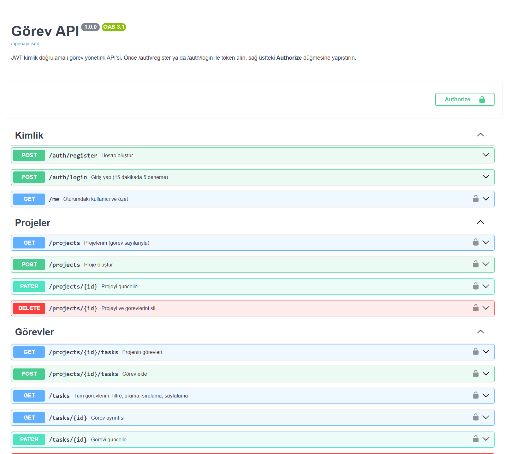

# Görev API — JWT'li Görev Yönetimi REST API'si

[](https://github.com/ilkertokat/gorev-api/actions)


**Kullanıcı hesapları, projeler ve görevler için güvenli, test edilmiş ve belgelenmiş bir REST API.** Node 24'ün yerleşik SQLite modülünü ve TypeScript desteğini kullanır: derleme adımı yok, veritabanı sunucusu yok, yalnızca iki çalışma zamanı bağımlılığı (Express, Zod).

> *English summary below.*



## Özellikler

- 🔐 **Kimlik doğrulama:** Kayıt / giriş, `scrypt` + rastgele tuzla parola özeti, HS256 JWT
- 🛡️ **Güvenlik önlemleri:**
  - Giriş denemelerinde kayan pencereli hız sınırı (15 dakikada 5)
  - Hatalı giriş mesajı, e-postanın kayıtlı olup olmadığını sızdırmaz
  - Başka kullanıcının kaynağına erişim **404** döner (kaynağın varlığı bile sızdırılmaz)
  - JWT'de yalnızca HS256 kabul edilir (`alg: none` ve algoritma karıştırma reddedilir), imza sabit sürede karşılaştırılır
  - Tüm SQL sorguları parametreli; sıralama alanları beyaz listeden gelir
- 📁 **Projeler ve görevler:** CRUD, zincirleme silme, proje başına görev ve tamamlanan sayıları
- 🔎 **Listeleme:** Durum / öncelik filtresi, başlık ve açıklamada arama, süresi geçenler, 6 sıralama seçeneği, sayfalama (`meta.total`, `meta.pages`)
- ✅ **Doğrulama:** Zod şemaları; hatalar alan bazında, Türkçe ve her zaman aynı biçimde
- 📘 **OpenAPI 3.1** dokümanı (`/openapi.json`) ve tarayıcıdan denenebilir **Swagger UI** (`/docs`)
- 🐳 Dockerfile (root olmayan kullanıcı, kalıcı veri birimi) · GitHub Actions: tip denetimi + testler

## Hızlı başlangıç

```bash
npm install
JWT_SECRET="en-az-32-karakterlik-gizli-bir-anahtar" npm start   # http://localhost:3000/docs
npm test            # 12 test (gerçek HTTP sunucusu + bellek içi veritabanı)
npm run typecheck
```

Docker:

```bash
docker build -t gorev-api .
docker run -p 3000:3000 -e JWT_SECRET="..." -v gorev-data:/data gorev-api
```

## Örnek

```http
GET /tasks?status=todo&sort=-priority&limit=2
Authorization: Bearer <token>
```

```json
{
  "data": [
    { "id": 1, "project_id": 1, "title": "Ana sayfa tasarımı", "status": "todo", "priority": 3, "due_date": "2026-10-10" },
    { "id": 2, "project_id": 1, "title": "İletişim formu", "status": "todo", "priority": 2, "due_date": null }
  ],
  "meta": { "page": 1, "limit": 2, "total": 2, "pages": 1 }
}
```

Hatalı istek:

```json
{
  "error": {
    "code": "validation_error",
    "message": "Gönderilen veri geçersiz",
    "details": [
      { "field": "title", "message": "Başlık gerekli" },
      { "field": "priority", "message": "Öncelik 1-3 arası olmalı" }
    ]
  }
}
```

Daha fazla örnek: [`docs/istekler.http`](docs/istekler.http) (VS Code REST Client ile doğrudan çalıştırılabilir).

## Uçlar

| Yöntem | Uç | Açıklama |
|---|---|---|
| `POST` | `/auth/register` | Hesap oluştur, token döner |
| `POST` | `/auth/login` | Giriş yap (hız sınırlı) |
| `GET` | `/me` | Kullanıcı ve görev özeti |
| `GET` · `POST` | `/projects` | Projelerim · proje oluştur |
| `PATCH` · `DELETE` | `/projects/:id` | Güncelle · sil (görevleriyle birlikte) |
| `GET` · `POST` | `/projects/:id/tasks` | Projenin görevleri · görev ekle |
| `GET` | `/tasks` | Tüm görevlerim: `status`, `priority`, `q`, `overdue`, `sort`, `page`, `limit` |
| `GET` · `PATCH` · `DELETE` | `/tasks/:id` | Görev ayrıntısı · güncelle · sil |

## Mimari

```
src/
├── server.ts     # giriş noktası, ortam değişkenleri
├── app.ts        # Express uygulaması: rotalar, sahiplik denetimi, listeleme sorgusu
├── db.ts         # node:sqlite şeması (yabancı anahtarlar, CHECK kısıtları, indeksler)
├── security.ts   # scrypt, HS256 JWT, kayan pencere hız sınırlayıcı
├── errors.ts     # tek tip hata biçimi, Zod → 400 dönüşümü
└── openapi.ts    # OpenAPI 3.1 tanımı ve Swagger UI sayfası
test/
├── security.test.ts  # parola, JWT sahteciliği / süre aşımı / alg:none, hız sınırı
└── api.test.ts       # uçtan uca: kayıt, giriş, kullanıcı izolasyonu, filtre/sayfalama, hata biçimi
```

Testler ek kütüphane kullanmıyor: Node'un yerleşik `node:test` aracı, rastgele portta gerçek bir sunucu açıp `fetch` ile istek atıyor.

---

## English

**Görev API** ("task API") is a secure, tested and documented REST API for users, projects and tasks, built on Node 24 with native TypeScript execution and the built-in `node:sqlite` module — no build step, no database server, only Express and Zod at runtime. It features scrypt password hashing, HS256 JWTs (rejecting `alg: none`), login rate limiting, per-user data isolation (foreign resources return 404), filtering/search/sorting/pagination, consistent Turkish validation errors, an OpenAPI 3.1 spec with Swagger UI, a Dockerfile and CI. 12 integration and unit tests use only `node:test` against a real HTTP server with an in-memory database.

## Lisans

MIT © 2026 İlker Tokat
